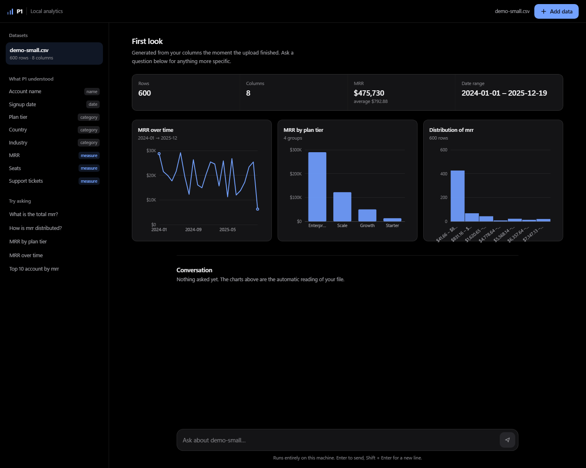
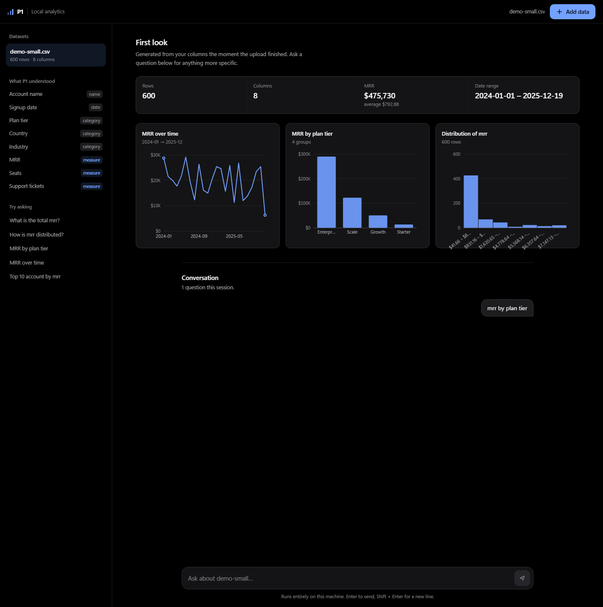
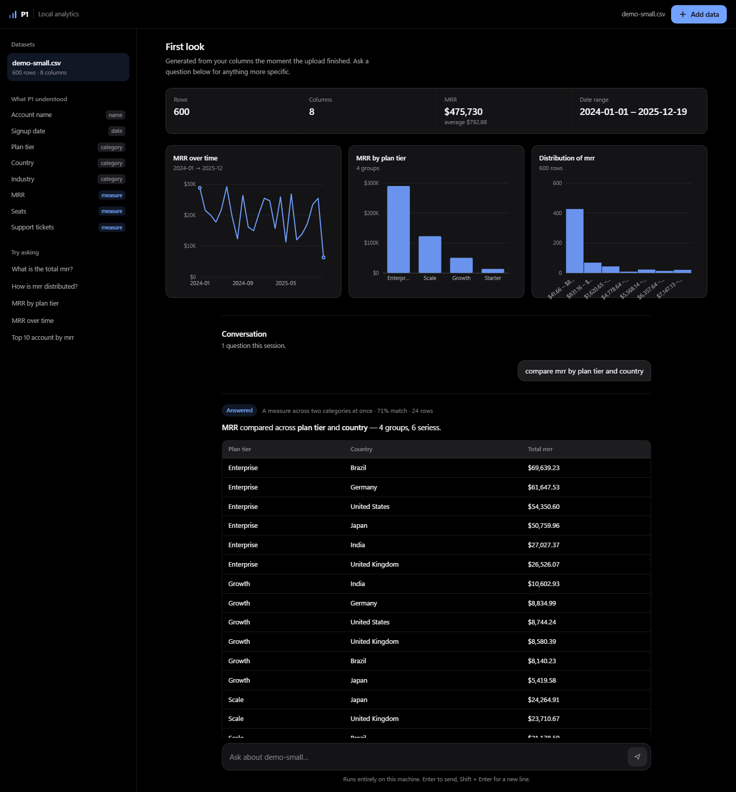
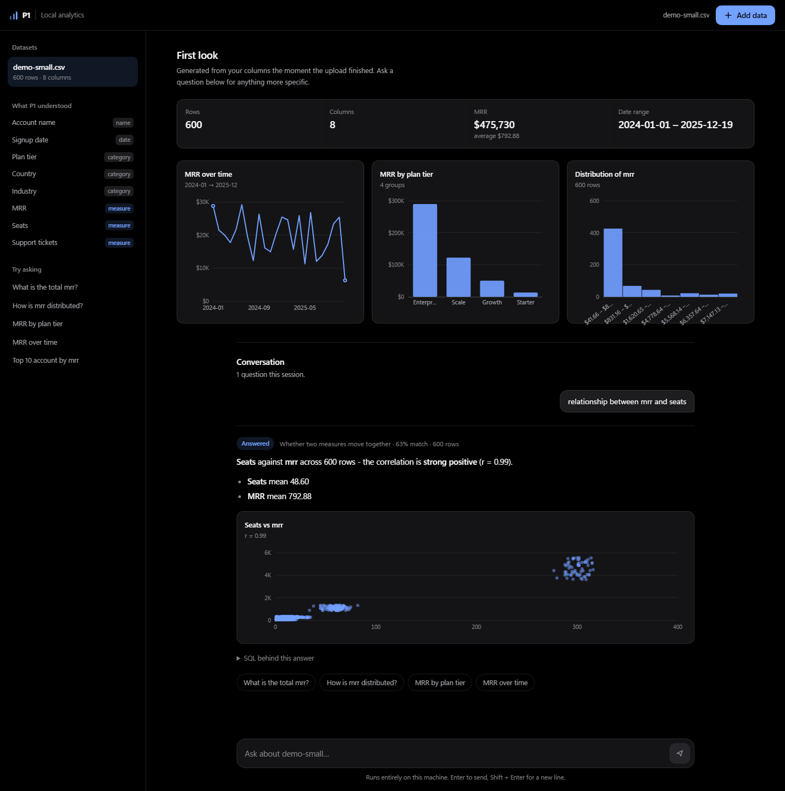
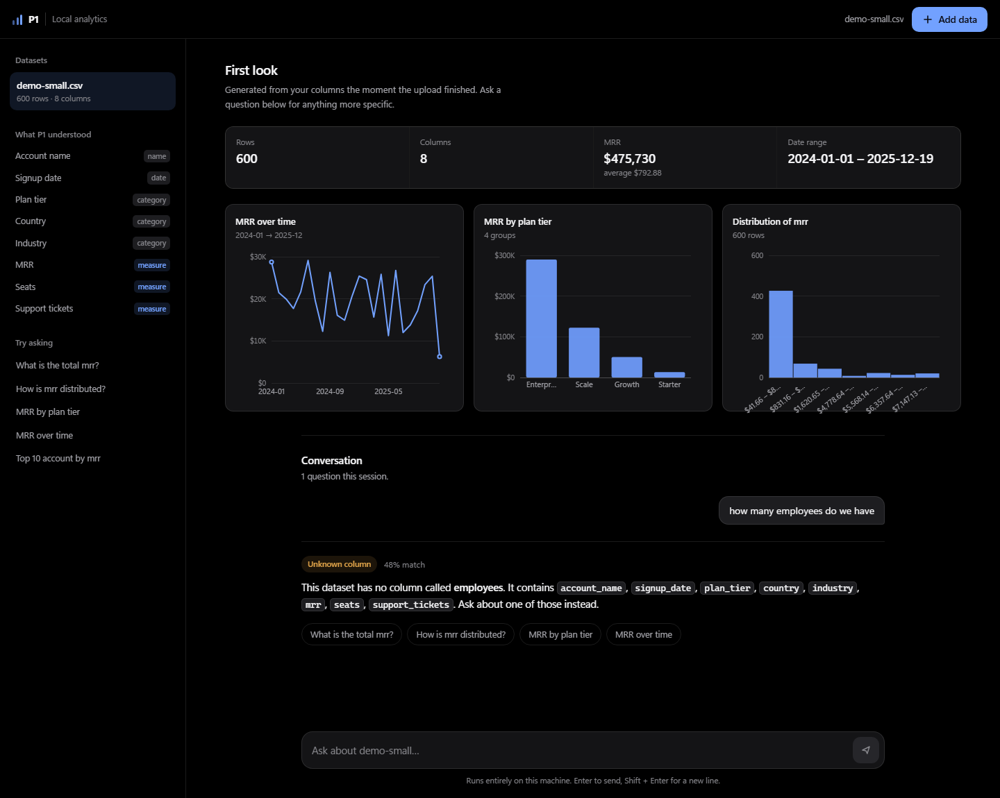

# P1 · Local Data Analytics

Point it at a spreadsheet. Ask questions in plain English. Get charts and tables back.

**No Docker. No cloud LLM. No API keys. No sample data.** Every number the app shows
is computed from the files *you* upload — nothing is shipped with the code.

```
┌──────────────────────┐         ┌──────────────────────────────────────────────┐
│  React + Vite        │  HTTP   │  FastAPI  (:8000)                            │
│  :5173               │ ──────► │                                              │
│  upload · charts     │  JSON   │  ┌────────────────────────────────────────┐  │
│  chat · markdown     │         │  │ SemanticRouter                         │  │
└──────────────────────┘         │  │  all-MiniLM-L6-v2 · CPU · local        │  │
                                 │  │  embedding + grammar → analysis type   │  │
                                 │  └────────────────────────────────────────┘  │
                                 │                    │                         │
                                 │                    ▼                         │
                                 │  ┌────────────────────────────────────────┐  │
                                 │  │ SchemaBinder                           │  │
                                 │  │  question nouns → real column names    │  │
                                 │  └────────────────────────────────────────┘  │
                                 │                    │                         │
                                 │                    ▼                         │
                                 │  ┌────────────────────────────────────────┐  │
                                 │  │ DuckDB (in-memory, per dataset)        │  │
                                 │  │  ← your .csv / .xlsx / .json           │  │
                                 │  └────────────────────────────────────────┘  │
                                 └──────────────────────────────────────────────┘
```

**Why this design.** The hard, failure-prone part of text-to-SQL is *writing the
query*. This app removes that problem rather than solving it. There is a fixed
catalogue of eight **analysis templates** — total, breakdown, trend, ranking,
distribution, comparison, correlation, preview — each a hand-written query with a
known-good shape. Two small classification jobs are left, and a 22M-parameter
model handles both on CPU:

1. **Which shape is this question?** — the router.
2. **Which of your columns does it mean?** — the binder.

The model never emits SQL. `SUM`, `AVG`, `GROUP BY` and every identifier come from
template code, so there is no injection surface and no hallucination risk.

---

## Screenshots

**The first look** — the moment an upload finishes, before you ask anything.
Every chart here was generated automatically from the column profile:



**A breakdown** — *"mrr by plan tier"*. Prose, chart and the underlying table:



**A cross-tab** — *"compare mrr by plan tier and country"*, one series per country:



**A correlation** — *"relationship between mrr and seats"*, with the actual
coefficient in the answer:



**The unknown-column path** — ask about something your file does not contain and
the app names the columns it *does* have instead of guessing:



The app also accepts a deep link — `http://localhost:5173/?q=mrr%20by%20plan%20tier`
asks the question automatically on load.

---

## Phase 0 · Prerequisites

| Requirement | Version | Notes |
|---|---|---|
| Python | 3.11+ (3.13 verified) | `python --version` |
| Node.js | 18+ (24.20 verified) | includes npm |
| Disk | ~3 GB free | mostly the CPU-only PyTorch wheel (~250 MB) + model cache (~90 MB) |
| RAM | 4 GB+ | ~400 MB resident with the model loaded |

No GitHub CLI is required — plain `git` is enough.

---

## Phase 1 · Backend

```powershell
cd backend

# 1. Create the virtual environment
python -m venv .venv

# 2. Activate it (PowerShell)
.\.venv\Scripts\Activate.ps1
#    cmd.exe:      .venv\Scripts\activate.bat
#    Git Bash:     source .venv/Scripts/activate
#    If PowerShell blocks the script:
#    Set-ExecutionPolicy -Scope Process -ExecutionPolicy Bypass

# 3. Install CPU-only PyTorch FIRST (avoids the ~2.5 GB CUDA build on Windows)
pip install torch --index-url https://download.pytorch.org/whl/cpu

# 4. Install the rest
pip install -r requirements.txt

# 5. Run the API
uvicorn main:app --reload --port 8000
```

The first start downloads `all-MiniLM-L6-v2` (~90 MB) into `backend/.cache/huggingface`.
Subsequent starts are offline and take ~20–60 s on a laptop CPU. **The model loads
on a background thread**, so the server answers `/api/health` immediately while it
warms — the UI shows a "Warming up" pill until it is ready.

**Verify it:**

```powershell
curl http://localhost:8000/api/health
# {"status":"ok","model":"sentence-transformers/all-MiniLM-L6-v2", ... ,
#  "model_state":"ready","analyses":8,"threshold":0.42,"datasets":0}
```

---

## Phase 2 · Frontend

```powershell
cd frontend
npm install
npm run dev
```

Vite serves on **http://localhost:5173**. CORS is open to `localhost:*` on the
backend, so the two talk directly.

---

## Phase 3 · Run it

1. Open http://localhost:5173 — you land on an empty state, because there is no
   data yet.
2. Drop a CSV/XLSX/JSON onto the dropzone (or click **Choose files**). Limits:
   **64 MB**, **20 files** per upload.
3. The moment ingestion finishes you get a **first look**: row/column counts, the
   headline metric, the date range, and up to three auto-generated charts.
4. Ask anything in the composer.

| Question | Shape matched |
|---|---|
| What is the total mrr? | `overview` |
| MRR by plan tier | `breakdown` |
| MRR over time | `trend` |
| Top 10 accounts by mrr | `ranking` |
| Distribution of mrr | `distribution` |
| Compare mrr by plan tier and country | `comparison` |
| Relationship between mrr and seats | `correlation` |
| What columns do we have? | `preview` |

Names come from **your** file. The examples above use a subscriptions CSV with an
`mrr` column; a shop's `revenue` column works identically.

---

## How a question becomes an answer

### 1. Router — *which shape?*

Every analysis template carries ~10 example phrasings. All of them are encoded
once at startup with `normalize_embeddings=True`. A question is embedded the same
way and each template keeps its **best** example score.

Cosine similarity alone is not enough. MiniLM scores are compressed — *"what is
the total revenue"* and *"what is the total"* are only 0.64 apart — and the model
is blind to grammar: it cannot tell `revenue by region` from `revenue by region
and product`. So a **lexical layer** adds evidence on top of the embedding:

| Layer | What it catches | Weight |
|---|---|---|
| Strong signals | `total`, `top`, `distribution`, `trend`, `relationship`, … | +0.15 each, capped at +0.26 |
| Weak signals | `most`, `each`, `per`, `daily`, … | +0.07 each |
| **Structure** | `by x and y` → comparison; `versus`/`vs` → comparison; `by x` → breakdown; `relationship`/`correlate` → correlation | ±0.20 to +0.30, **uncapped** |

The structure layer sits outside the cap on purpose. Grammar is what the
embedding model is worst at, so those hints are allowed to be decisive: a
question that names two grouping columns *is* a cross-tab, regardless of what the
cosine score thinks.

The template examples are deliberately **schema-neutral** (`total by category`,
`values over time`, `relationship between two measures`) so the router works
before any dataset exists. Domain nouns in the examples made routing collapse on
unfamiliar schemas.

### 2. Binder — *which column?*

The router knows the shape but not the schema. The binder maps the question's
nouns onto real columns by combining:

- **lexical overlap** with the column's own name and label, weighted 3× (`MRR`
  matches `mrr`; `plan tier` matches `plan_tier`), and
- **cosine similarity** with a one-line description of the column, which breaks
  ties (`headcount` → `seats`).

It then assigns roles — **metric**, **dimension**, **time**, **entity** — from
the column name, DuckDB type and sample values. `customer_id` is an entity, not a
metric, because a numeric identifier is not a number you sum. Near-unique text
columns are entities too, not categories you can group by.

### 3. Guard layers

A single similarity threshold cannot separate
*"how many employees do we have"* (0.52) from
*"give me the big picture numbers"* (0.53) — the sentences are structurally
identical. So refusal is layered:

1. **Vocabulary guard** — a question naming a term the data has never heard of
   (`employee`, `headcount`, `weather`, …) is refused before it is embedded.
2. **Negative class** — out-of-scope phrases live in the **same index** but are
   not templates. If the closest one lands within `0.03` of the closest template,
   the question is refused.
3. **Similarity floor** — below `0.42` it is refused outright.
4. **Ambiguity margin** — if the runner-up is within `0.05` of the winner, the
   user is offered both readings instead of a coin flip.
5. **Unknown column** — the router cannot know your schema, so it never rejects a
   question for naming a missing column. The binder does, and the answer lists the
   columns the dataset actually has.

**The app never runs SQL for a question it could not map to a known shape.**

---

## Analysis templates

| Template | Shape | Needs | Chart |
|---|---|---|---|
| `overview` | one row of totals, averages, min/max | metric | — (a six-number summary is not a chart) |
| `breakdown` | one measure split by one category | metric + dimension | vertical bars |
| `trend` | one measure over time | metric + time | line + area |
| `ranking` | top N rows by a measure | metric + entity | horizontal bars |
| `distribution` | one measure bucketed into 10 bins | metric | histogram |
| `comparison` | one measure across two categories | metric + 2 dimensions | grouped bars |
| `correlation` | two measures plotted, with *r* | 2 metrics | scatter |
| `preview` | the first N rows of the table | — | — |

Charts are returned as **JSON specs** (`type`, `title`, `points`, optional
`series`) and rendered by the client as inline SVG. There is no charting library
and **no pie charts** — a bar, a line and a scatter cover these shapes honestly.

---

## Project layout

```
P1/
├── .gitignore
├── README.md
├── PROGRESS.md                      # build status / handoff notes (not tracked)
│
├── backend/
│   ├── .venv/                       # virtualenv (gitignored)
│   ├── .cache/huggingface/          # model cache (gitignored, ~90 MB)
│   ├── .data/                       # your uploaded datasets (gitignored)
│   ├── .env.example
│   ├── requirements.txt
│   ├── main.py                      # ★ FastAPI app: routes, chat pipeline, suggestions
│   ├── analytics/
│   │   ├── config.py                # every knob is a P1_* env var
│   │   ├── ingest.py                # CSV/TSV/JSON/JSONL/XLSX → normalised tables
│   │   ├── store.py                 # dataset persistence + DuckDB connections
│   │   ├── profile.py               # ★ profiling, column roles, SchemaBinder
│   │   ├── router.py                # ★ semantic + lexical + grammatical routing
│   │   ├── analyses.py              # ★ the 8 templates: plan → SQL → prose + chart
│   │   ├── insights.py              # auto-generated first-look charts
│   │   └── formatting.py            # money/percent/number formatting, markdown tables
│   ├── smoke_test.py                # ★ engine suite: SQL, routing, injection, persistence
│   └── api_test.py                  # ★ HTTP suite: upload → schema → insights → chat
│
└── frontend/
    ├── package.json
    ├── vite.config.js
    ├── index.html
    └── src/
        ├── main.jsx
        ├── App.jsx                  # ★ upload, dataset rail, insights, chat, markdown
        ├── Chart.jsx                # ★ dependency-free SVG chart renderers
        ├── api.js                   # fetch client (VITE_API_BASE aware)
        ├── index.css                # design tokens, light + dark
        └── markdown.verify.jsx      # ★ server-side render + XSS-safety suite
```

---

## Supported files

| Format | Extensions |
|---|---|
| Delimited text | `.csv`, `.tsv`, `.txt` (delimiter sniffed) |
| JSON | `.json` (array of objects), `.jsonl`, `.ndjson` |
| Excel | `.xlsx`, `.xlsm` (one table per sheet) |

Type inference is DuckDB's `read_csv_auto` / `read_json_auto`. Missing values,
ragged rows and mixed-type columns are coerced rather than fatal; anything the
ingester had to guess is reported back as a warning in the upload response and
shown in the UI.

Datasets are copied into `backend/.data/` and rebuilt into DuckDB from those
normalised CSVs on startup, so **uploads survive a restart**. Nothing is uploaded
anywhere; the `.data` directory never leaves your machine.

---

## API reference

| Method | Endpoint | Purpose |
|---|---|---|
| `GET` | `/api/health` | liveness, model name, `model_state`, dataset count |
| `GET` | `/api/meta` | analyses, tuning values, dataset-scoped suggestions |
| `GET` | `/api/schema` | tables, columns, inferred roles |
| `GET` | `/api/insights` | auto-generated first-look charts for the active dataset |
| `GET` | `/api/datasets` | list uploaded datasets |
| `POST` | `/api/datasets` | upload one or more files → ingest, profile, activate |
| `POST` | `/api/datasets/{id}/activate` | switch the active dataset |
| `DELETE` | `/api/datasets/{id}` | remove a dataset and its stored files |
| `POST` | `/api/chat` | `{ "question": "..." }` → answer, SQL, rows, chart |
| `GET` | `/docs` | interactive OpenAPI UI |

`/api/chat` response (abridged):

```json
{
  "status": "ok",
  "answer": "**MRR** by **plan tier** - 4 groups, led by **Enterprise** at $289,950.76.\n\n| ... |",
  "analysis": "breakdown",
  "analysis_description": "One measure split by a category",
  "confidence": 0.5612,
  "sql": "SELECT \"plan_tier\" AS label, SUM(\"mrr\") AS value, COUNT(*) AS records FROM ...",
  "columns": [{ "key": "label", "label": "Plan tier", "unit": "text" }],
  "rows": [{ "label": "Enterprise", "value": 289950.76 }],
  "row_count": 4,
  "chart": { "type": "bar", "title": "MRR by plan tier", "points": [] },
  "binding": { "metric": "mrr", "dimension": "plan_tier", "unmatched": [] },
  "suggestions": ["What is the total mrr?", "..."],
  "dataset": "subscriptions.csv"
}
```

`status` is one of `ok` · `ambiguous` · `fallback` · `needs_column` ·
`needs_dataset` · `error`.

---

## Security

**Identifiers.** SQL column and table names come only from DuckDB introspection,
never from the question. Each is quoted with `quote_ident`, which doubles embedded
quotes. The question text is never interpolated — not even into a `LIKE`.

**Exfiltration.** Rows are capped by `P1_RESULT_ROW_CAP` (default 500).

**Markdown.** Answers are rendered with `react-markdown` + `remark-gfm`:

- `rehype-raw` is not installed, and `skipHtml` removes HTML nodes outright, so
  raw HTML in an answer never becomes live DOM;
- `urlTransform` uses react-markdown's default allow-list, which strips
  `javascript:` and `data:` URLs from links and images;
- `remark-gfm` cannot emit script or event handlers.

`npm run verify:markdown` proves all three against a hostile payload.

**Uploads.** Size and file-count ceilings are enforced before parsing.

---

## Verification

Two suites ship with the project. Run both before you trust a change.

### Engine suite — SQL, routing, injection, persistence

```powershell
cd backend
.\.venv\Scripts\python.exe smoke_test.py
```

Builds its own fixture, then asserts: every template plans and executes against
the warehouse; column roles are inferred correctly; a held-out set of paraphrases
routes to the right shape; off-domain questions are refused; near-misses are not
force-fitted; SQL-injection payloads survive and every generated identifier is
quoted; insights produce charts; a dataset survives a simulated restart.

```
PASSED: 55
FAILED: 0
ALL CHECKS PASSED
```

### HTTP suite — the real API surface

```powershell
# in one shell:
cd backend; .\.venv\Scripts\python.exe -m uvicorn main:app --port 8000
# in another:
cd backend; .\.venv\Scripts\python.exe api_test.py
```

Generates its own CSV and two-sheet XLSX fixtures and drives the full HTTP
surface: health, upload, schema, insights, every analysis via `/api/chat`,
refusals, dataset switching and deletion.

```
PASSED: 63
FAILED: 0
ALL CHECKS PASSED
```

### Frontend — markdown rendering + XSS safety

```powershell
cd frontend
npm run verify:markdown
```

Renders the real `Markdown` component with `react-dom/server` and asserts on the
output: GFM tables become real `<table>` markup, lists become `<ul>/<li>`, raw
HTML never becomes live DOM, and `javascript:` URLs are stripped.

```
RESULT: PASS
```

---

## Tuning

Every knob is an environment variable. See `backend/.env.example`.

| Variable | Default | Effect |
|---|---|---|
| `P1_INTENT_THRESHOLD` | `0.42` | Lower = broader coverage, more false accepts |
| `P1_INTENT_AMBIGUITY_MARGIN` | `0.05` | Higher = more questions offered as two readings |
| `P1_SCOPE_MARGIN` | `0.03` | Higher = stricter out-of-scope refusal |
| `P1_RESULT_ROW_CAP` | `500` | Max rows returned to the browser |
| `P1_MAX_UPLOAD_BYTES` | `67108864` | 64 MB upload ceiling |
| `P1_MAX_UPLOAD_FILES` | `20` | Files per upload |
| `P1_STORE_DIR` | `backend/.data` | Where datasets are persisted |
| `P1_EMBEDDING_MODEL` | `all-MiniLM-L6-v2` | Swap for a bigger local model |
| `P1_EMBEDDING_DEVICE` | `cpu` | Set to `cuda` if you have a GPU |
| `P1_CORS_ORIGINS` | `localhost:5173` | Comma-separated allowed origins |

A misroute is almost always a **coverage** problem, not a threshold problem — the
fix is usually to add a paraphrase to the template's `examples` or a signal to
`LEXICAL_SIGNALS`, not to move the threshold.

---

## Adding a capability

Add an `Analysis` to `ANALYSES` in `backend/analytics/analyses.py`. Nothing else
changes — the router indexes it, the binder resolves its columns, the API and UI
render its chart.

```python
Analysis(
    name="discount_impact",
    description="How much revenue discounts cost us",
    examples=(
        "how much are discounts costing us",
        "impact of discounts on revenue",
        "what do discounts cost",
    ),
    plan=_plan_discount_impact,      # Binding -> Plan(sql, columns, labels)
    render=_render_discount_impact,  # rows -> (prose, chart spec)
    needs=("metric", "dimension"),
)
```

Rules of thumb:

- Write **genuine paraphrases**, not keywords, and keep the nouns *generic* so the
  template works on schemas you have not seen.
- `plan()` must build SQL only from `quote_ident(column.name)` and a table name
  taken from the binding.
- Raise `NeedsColumn` when a required role has no candidate; `main.py` turns that
  into a `needs_column` answer listing the available columns.

---

## Troubleshooting

| Symptom | Cause | Fix |
|---|---|---|
| Header shows "Warming up" for a minute | model loading on first start | wait; it is cached after the first run |
| Header shows "Backend offline" | uvicorn not running | start it on :8000 |
| `ModuleNotFoundError: duckdb` | wrong interpreter | confirm the venv is active: `python -c "import sys; print(sys.executable)"` |
| pip downloads a 2.5 GB torch | CUDA build pulled in | install the CPU wheel first (Phase 1, step 3) |
| Every question falls back | threshold too high | lower `P1_INTENT_THRESHOLD` to `0.35` |
| A valid column is "unknown" | role inference guessed wrong | check `/api/schema`; near-unique text columns are classified as entities |
| Upload rejected | over 64 MB or 20 files | raise `P1_MAX_UPLOAD_BYTES` / `P1_MAX_UPLOAD_FILES` |
| Port already in use | stale process | `Get-NetTCPConnection -LocalPort 8000 \| Select OwningProcess` then `Stop-Process -Id <pid>` |
| `npm` not recognised | Node not on PATH | `& "C:\Program Files\nodejs\npm.cmd" install` |

---

## Performance

Measured on a laptop CPU, with the model already loaded.

| Operation | Time |
|---|---|
| Model load (cached, background thread) | ~20–60 s |
| Question embedding | ~12 ms |
| Route + bind | <5 ms |
| DuckDB query | ~5–40 ms |
| **End-to-end** | **~60 ms** |
| Ingest 1,400-row CSV | ~150 ms |

---

## Deploying this repo

```powershell
git add -A
git commit -m "P1: local analytics app on uploaded data (React + FastAPI + DuckDB)"
git push -u origin main
```

`.gitignore` excludes `.venv/`, `node_modules/`, `dist/`, the model cache and
`backend/.data/`, so the repository carries code only — **no data**.
